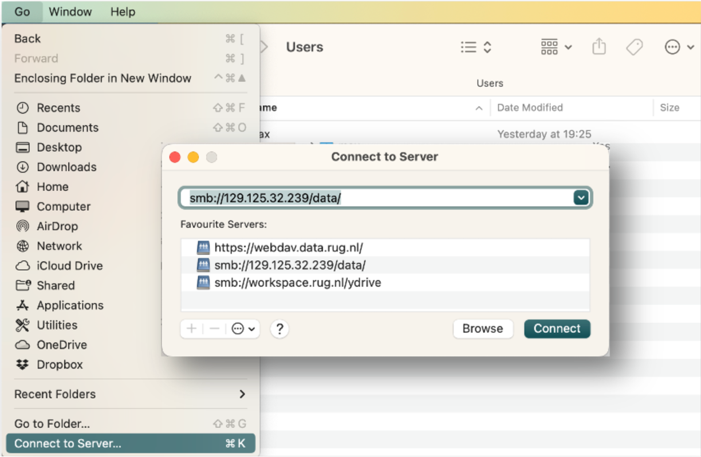

# Onboarding: Setting Up Your Mac for Computational Biology

## Contents

- [Administrative](#administrative)
- [University IT Systems](#university-it-systems)
- [macOS Basics](#macos-basics)
- [Terminal Setup](#terminal-setup)
- [Homebrew](#homebrew)
- [Shell Configuration](#shell-configuration)
- [macOS Defaults & Tweaks](#macos-defaults--tweaks)
- [HPC Cluster Access (Habrok)](#hpc-cluster-access-habrok)
- [File Sharing & Backups](#file-sharing--backups)
- [Python Setup](#python-setup)
- [Code Editor](#code-editor)
- [Git and Version Control](#git-and-version-control)
- [Finding Answers](#finding-answers)
- [AI-Assisted Coding](#ai-assisted-coding)

## Administrative

- Start by getting access to your email and My University — you'll need both for many of the following tasks. You log in with your p-number, password, and two-factor authentication, so install the Google Authenticator app ([MFA setup instructions](https://www.rug.nl/society-business/centre-for-information-technology/security/multi-factor-authentication?lang=en)) on your phone first.
- Contact Sandra Haan (our secretary, secbc@rug.nl) for administrative onboarding and to obtain your university card. Ask her to add you to the biotechnology email list as well. She will also have some forms for you to fill in, and she or Hugo can provide you with an office key.
- Request access to the Habrok high-performance cluster here: [Habrok account request](https://rug.topdesk.net/tas/public/ssp/content/serviceflow?unid=a98b8758-b37a-4b6f-943e-0edf81b1be29). If that link doesn't work, log in to the [CIT help portal (IRIS)](https://iris.service.rug.nl/) and search for "Habrok". In the form, mention that you're a computational PhD doing MD simulations.
- Some software can be downloaded from the [university software portal](https://iris.service.rug.nl/tas/public/ssp/content/detail/service?unid=eaf8ada50c7846b792798f1addb69f8e&from=d74117e5-047a-4378-bb03-3510cf8871d1). Other software like Office and Adobe can be downloaded directly from their websites after logging in with your @rug.nl email address. (This process changes occasionally — check IRIS for help if it doesn't work.)
- Got a new Mac / a computer not hooked up to the wired (ethernet) network? Request access to the network in [Iris](https://rug.topdesk.net/tas/public/ssp/content/serviceflow?unid=ea6373cf-cf1f-4a1b-a80a-57e26afb3f26) (search for "Request access to the wired network" if the link does not work). Wired connections are more stable and faster than the eduroam wifi. You'll need the mac address of the ethernet adapter; run `networksetup -listallhardwareports` to find your Ethernet device (e.g. en3), then execute `ifconfig <device> | grep ether` (or simply `networksetup -getmacaddress Ethernet`) to print its MAC address.

## University IT Systems

A few useful university services to be aware of:

- **[My University (Intranet)](https://myuniversity.rug.nl/infonet/medewerkers/dashboard/)** — The staff dashboard. Check out the **IT section** there for guides on email, Wi-Fi, printing, and more.
- **[IRIS Knowledge Base](https://rug.topdesk.net/tas/public/ssp/)** — The IT self-service portal. Use it to request accounts (Habrok, VPN, etc.), report issues, and browse how-to articles.
- **[University Workspace (UWP)](https://uwp.rug.nl/)** — A virtual Windows desktop you can access from any browser. Useful when you need a Windows-only application or want to access university systems from a non-managed device.
- **[Laptop/Tablet Reimbursement](https://myuniversity.rug.nl/infonet/medewerkers/werk-en-carriere/voorwaarden/vergoedingen/tabletregeling/)** — The university partially reimburses the purchase of a laptop or tablet for work use.
- **[Print Portal](https://rug.mycampusprint.nl/Print/Default)** — Upload documents to print at any campus printer using your university card.

## macOS Basics

Below are some instructions for making your Mac a productive environment. You may already know some of these — apologies if parts are a bit basic.

- **The Dock** sits at the bottom of the screen and shows running and pinned applications. Clean it up by removing apps you don't use (right-click the icon) and pin the ones you use often.
- **Switching windows:** Use `Cmd + Tab` to switch between apps, or press `F3` (Mission Control) to see all open windows at once.
- **Spotlight:** Press `Cmd + Space` to quickly search for any program, document, or setting.
- **Finder** is the macOS equivalent of Windows Explorer. Try the different view modes (list, columns, etc.).
- **System Settings** are found under the Apple menu in the top-left corner. The menu bar at the top of the screen always belongs to the currently active (foreground) application.
- **Installing apps:** Mac installers come in two forms. A `.dmg` disk image: open it, then drag the app icon into your Applications folder. A `.pkg` installer: double-click and follow the steps. Some apps are also available directly from the App Store.

## Terminal Setup

macOS is based on UNIX and shares the same core structure as Linux. This means you have access to a full UNIX command line. You'll use the terminal a lot in computational biology, so it's worth spending some time making it comfortable.

A good first step is to install [iTerm2](https://iterm2.com/), a modern replacement for the built-in Terminal app. Have a look at its settings and pick a colour scheme you like.

## Homebrew

Next, install [Homebrew](https://brew.sh/) — the package manager for macOS. It lets you install almost any command-line tool or desktop application with a single command. It will also install the Xcode Command Line Tools, which provide essential developer utilities.

After installation, Homebrew may tell you to add its directory to your `PATH`. This is a standard UNIX concept: the `PATH` environment variable (view it with `echo $PATH`) tells the OS where to look for programs.

Most command-line programs install into standard locations automatically, but some end up in a separate directory that you need to add to your `PATH` manually.

> **Note:** In documentation, terminal commands are typically shown in `monospace` or  \`backticks\` . A leading `$` indicates a shell prompt, e.g. `$ echo "hello"` means you should type `echo "hello"` into a shell. Don't confuse this with the $ used to denote UNIX variables:
>```
>$ my_variable=1
>$ echo $my_variable
>```
>Note further that actually, variables in UNIX should additonally be [quoted](https://tldp.org/LDP/abs/html/quotingvar.html).


## Shell Configuration

### Bash vs. Zsh

Since macOS Catalina (2019), the default shell is **zsh**. The older default was **bash**. Both are excellent and share most concepts (PATH, aliases, environment variables, scripting basics). The main differences are in startup files and some syntax details. Pick whichever you prefer, but **make sure to update**, don't just use the built-in version:

| | **Bash** | **Zsh** |
|---|---|---|
| Install latest | `brew install bash` | Built-in (or `brew install zsh`) |
| Set as default | `chsh -s /opt/homebrew/bin/bash` | `chsh -s /bin/zsh` (already default) |
| Config files | `~/.bash_profile`, `~/.bashrc` | `~/.zprofile`, `~/.zshrc` |
| Silence deprecation warning | `export BASH_SILENCE_DEPRECATION_WARNING=1` | N/A (zsh is already the default) |

> **Recommendation:** If you're new to the command line, sticking with **zsh** (the default) is the simplest option. If you prefer bash or need it for compatibility, install a modern version via Homebrew — the one bundled with macOS is very outdated (v3.2, from 2007) due to licensing.

### Editing Config Files

To add something to your `PATH`, use the `export` command. To avoid repeating this every time you open a terminal, place the command in your shell's startup file:

- **Zsh:** `~/.zshrc` (loaded for every interactive shell)
- **Bash:** `~/.bashrc` (you may need to source it from `~/.bash_profile` — see below)

A few notes on these files:

- `~` is a shortcut for your home folder, e.g. `/Users/max/`
- The `.` prefix makes the file hidden — but it's still just a plain text file you can edit

To edit text files from the terminal, you have two options:

1. **Graphical editor:** Run `open -e <file>` to open it in TextEdit — easiest for beginners.
2. **Terminal editor:** Unless you're already familiar with `vim`, start with `nano` (run `nano <file>`). It works like a regular editor with arrow-key navigation. Keyboard shortcuts are listed at the bottom of the screen — `^` means the Ctrl key, so `^X` means `Ctrl + X` to exit.

**If using bash**, most people auto-load `.bashrc` by adding these lines to `~/.bash_profile`:

```bash
if [ -f $HOME/.bashrc ]; then
        source $HOME/.bashrc
fi
```

**If using zsh**, you can put everything directly in `~/.zshrc` — no extra wiring needed.

Add the Homebrew PATH to your config file (e.g. `~/.zshrc` or `~/.bashrc`):

```bash
export PATH=/opt/homebrew/bin:$PATH
```

Save the file (`Ctrl + X`, confirm with `y`) and reload it so the changes take effect in your current session:

```bash
source ~/.zshrc    # or: source ~/.bashrc
```

Verify that Homebrew works by running `brew --version`. If it prints a version number, you're all set.

### Customising Your Prompt

The prompt (the text before each command line) can show your username, current directory, colours, and more.

**Bash** uses the `PS1` variable:

```bash
# In ~/.bashrc — shows time, username, and current directory in green
export PS1='\t [\u@home] \[\e[0;32m\]/\W/\[\e[m\] $ '
```

**Zsh** uses the `PROMPT` variable with its own escape codes:

```zsh
# In ~/.zshrc — shows username, current directory in green, and a % prompt
PROMPT='%n@%m %F{green}%1~%f %# '
```

Google "customize bash prompt" or "customize zsh prompt" to learn more about the available escape codes.

### Tab Completion

Tab completion is one of the most useful tricks for efficient terminal navigation: pressing `Tab` auto-completes file, folder, and program names. For example, type `na` and press `Tab` to complete it to `nano` — unless another program also starts with "na", in which case the shell will either complete up to the common prefix, show all matches, or cycle through them.

By default, Bash only completes file and folder names. To enable smarter completions — like completing `git che<Tab>` to `git checkout` or `ssh <Tab>` to your known hosts — install the `bash-completion` package:

```bash
brew install bash-completion@2
```

Then add this to your `~/.bashrc`:

```bash
[[ -r "/opt/homebrew/etc/profile.d/bash_completion.sh" ]] && . "/opt/homebrew/etc/profile.d/bash_completion.sh"
```

**Bash** tab completion config (also add to `~/.bashrc`):

```bash
# cycle through matches on ambiguous tab completion
[[ $- = *i* ]] && bind TAB:menu-complete

# tab completion: ignore case
[[ $- = *i* ]] && bind 'set completion-ignore-case on'
```

**Zsh** tab completion config (add to `~/.zshrc`):

```zsh
# enable completion system
autoload -Uz compinit && compinit

# case-insensitive completion
zstyle ':completion:*' matcher-list 'm:{a-z}={A-Z}'

# cycle through matches with Tab
zstyle ':completion:*' menu select
```

Lines starting with `#` are comments and have no effect.

The rest of my config contains custom variables and aliases — you'll build up your own collection over time. There are many good "dotfiles" repositories online (e.g. [here](https://github.com/jflorez29/dotfiles)) with useful suggestions for aliases, exports, and functions.

## macOS Defaults & Tweaks

Below are some `defaults` commands and other tweaks I typically run on a fresh Mac. You can look up any of them for more details.

```bash
# copy / paste from the command line without text formatting
defaults write com.apple.Terminal CopyAttributesProfile com.apple.Terminal.no-attributes
```

### Installing Programs with Homebrew

```bash
# essential command-line tools
brew install coreutils moreutils findutils git tmux vim nvim

# search and navigation
brew install ripgrep fd fzf zoxide eza bat tree ag

# system monitoring and utilities
brew install htop bottom hyperfine tldr jq httpie highlight cowsay

# programming tools
brew install go pyenv

# media
brew install yt-dlp
```


Some useful GUI applications can be installed with `brew install --cask`:

```bash
brew install --cask iterm2 docker zoom vlc rectangle
```

### Screenshot Settings

```bash
# save screenshots to a dedicated folder
mkdir -p ~/Desktop/screenshots
defaults write com.apple.screencapture location ~/Desktop/screenshots
defaults write com.apple.screencapture type -string "png"

# Disable shadow in screenshots
defaults write com.apple.screencapture disable-shadow -bool true
```

### Finder & System Settings

```bash
# Enable subpixel font rendering on non-Apple LCDs
defaults write NSGlobalDomain AppleFontSmoothing -int 2

# Show extensions
defaults write NSGlobalDomain AppleShowAllExtensions -bool true

# Disable the warning before emptying the Trash
defaults write com.apple.finder WarnOnEmptyTrash -bool false

# Use list view in all Finder windows by default
# Four-letter codes for the other view modes: `icnv`, `clmv`, `Flwv`
defaults write com.apple.finder FXPreferredViewStyle -string "Nlsv"

# When performing a search, search the current folder by default
defaults write com.apple.finder FXDefaultSearchScope -string "SCcf"

# Disable the warning when changing a file extension
defaults write com.apple.finder FXEnableExtensionChangeWarning -bool false
```

### Dock Settings

```bash
# Show indicator lights for open applications in the Dock
defaults write com.apple.dock show-process-indicators -bool true

# Speed up Mission Control animations
defaults write com.apple.dock expose-animation-duration -float 0.1

# Remove the auto-hiding Dock delay
defaults write com.apple.dock autohide-delay -float 0

# Remove the animation when hiding/showing the Dock
defaults write com.apple.dock autohide-time-modifier -float 0.1

# Automatically hide and show the Dock
defaults write com.apple.dock autohide -bool true
```

### Activity Monitor

```bash
# Customise the Activity Monitor (like Task Manager in Windows)
defaults write com.apple.ActivityMonitor OpenMainWindow -bool true
defaults write com.apple.ActivityMonitor IconType -int 5
defaults write com.apple.ActivityMonitor ShowCategory -int 0
defaults write com.apple.ActivityMonitor SortColumn -string "CPUUsage"
defaults write com.apple.ActivityMonitor SortDirection -int 0
```

### iTerm2 Scrolling

To enable trackpad scrolling in `nano` inside iTerm2, follow [these instructions on Stack Overflow](https://stackoverflow.com/questions/50026644/how-to-use-the-trackpad-to-scroll-in-nano-using-iterm2-the-way-it-works-in-term).

## HPC Cluster Access (Habrok)

The university's HPC cluster is called **Habrok** (the previous cluster "Peregrine" has been retired). Once you receive confirmation that your account is active, you can log in using `ssh`:

```bash
ssh pnumber@login1.hb.hpc.rug.nl
```

> **Note:** Replace `pnumber` with your actual p-number (e.g. `p123456`). You may need to be on the [university VPN](https://doc.web.rug.nl/books/website-XVh/page/website-vpn-instellen-setup-vpn#english) if connecting from off-campus.

See the [Habrok documentation](https://wiki.hpc.rug.nl/habrok/start) for full details, including how to submit jobs with the SLURM workload manager.

### SSH Basics

`ssh` connects you to a remote UNIX computer — once connected, everything you type runs on that remote system. Other useful tools for working with remote machines are `scp` and `rsync` (for transferring files).

### SSH Keys

By default, SSH asks for your password every time. You can set up SSH keys for passwordless login:

```bash
# generate a key pair (press Enter to accept defaults)
ssh-keygen -t ed25519

# copy your public key to the remote server
ssh-copy-id pnumber@login1.hb.hpc.rug.nl
```

After this, `ssh` will use your key instead of asking for a password. Your private key stays in `~/.ssh/id_ed25519` (never share this), and the public key (`~/.ssh/id_ed25519.pub`) gets added to the remote server.

### SSH Config for Convenience

To avoid typing the full hostname every time, add an entry to `~/.ssh/config`:

```
Host habrok
    HostName login1.hb.hpc.rug.nl
    User pnumber
```

Now you can simply run `ssh habrok` to connect. This also works with `scp` and `rsync` (e.g. `scp file.txt habrok:~/`).

### Connecting to Your Own Mac Remotely

To find your Mac's local IP address, use `ipconfig getifaddr` — but the interface name depends on how you're connected:

- `en0` — Wi-Fi on most MacBooks; Ethernet on some desktop Macs
- `en1` (or higher) — Ethernet via a USB-C/Thunderbolt adapter, or Wi-Fi if `en0` is taken by Ethernet

If you're not sure which applies, just list all active addresses at once:

```bash
ifconfig | grep "inet " | grep -v 127.0.0.1
```

This shows every non-loopback IP on your machine — pick the one on your local network (typically `192.168.x.x` or `10.x.x.x`). Then connect from another machine with `ssh username@<that-ip>`. This requires a VPN connection to the university network when off-campus.

### Copying Files Back from a Remote Server (Reverse Tunnel)

Picture this: you're SSHed into a cluster, you've just run a simulation, and you're looking at the output files right there in the terminal. You want them on your local machine. The obvious approach is to open a second terminal on your Mac and run `rsync` or `scp` from there — but that means copying the full path, switching windows, and keeping track of two sessions. Isn't there a way to just trigger the download from where you already are, on the remote?

Yes. The trick is a **reverse SSH tunnel**: when you connect to the cluster, you tell SSH to also forward a port on the remote back to your Mac's SSH daemon. The cluster can then reach your Mac through that tunnel and push files directly with `rsync`.

The two main clusters people in the lab use are **Habrok** (`login1.hb.hpc.rug.nl`) and **Snellius** (`snellius.surf.nl`). The technique below applies to both — examples use Snellius (with the alias `ss`), but the same steps work for Habrok or any other remote.

**Step 1 — Connect with a reverse tunnel** (from your local Mac):

```bash
ssh -R 2222:localhost:22 ss
```

This makes `localhost:2222` on the remote point back to port 22 on your Mac.

**Step 2 — Create an SSH key on the remote** (for logging into your Mac):

```bash
ssh-keygen -t ed25519 -f ~/.ssh/mac_key
```

**Step 3 — Authorise that key on your Mac:**

On the remote, print the public key:

```bash
ssh-keygen -y -f ~/.ssh/mac_key
```

Copy the line it prints (starts with `ssh-ed25519 …`), then on your **local Mac** add it to:

```bash
nano ~/.ssh/authorized_keys
```

Fix permissions if needed (on your Mac):

```bash
chmod 700 ~/.ssh
chmod 600 ~/.ssh/authorized_keys
```

**Step 4 — Add a `mac` host alias on the remote** (in `~/.ssh/config` on the remote):

```sshconfig
Host mac
  HostName localhost
  Port 2222
  User yourLocalUsername
  IdentityFile ~/.ssh/mac_key
  IdentitiesOnly yes
```

The `IdentitiesOnly yes` line is important: without it, SSH may try other keys or fall back to a password prompt when you use a non-default key filename.

**Step 5 — Push files with rsync:**

```bash
rsync -av -e ssh file.txt mac:/local/path/
rsync -av -e ssh results/ mac:/local/path/
```

**Optional: `dl` shortcut** — add this to your shell startup file on the remote (`~/.bashrc` or `~/.zshrc`) to push to a fixed local folder with a short command:

```bash
dl() {
  rsync -avh --progress -e ssh "$@" mac:/local/path/
}
```

Reload with `source ~/.bashrc`, then just run `dl results/` or `dl file.txt`.

**Verifying it works:** To watch your Mac accept the connection in real time, run this on your Mac while testing from the remote:

```bash
log stream --style syslog --predicate 'process == "sshd"' --info
```

You should see a line like `Accepted publickey for yourLocalUsername from ::1 port ...`.

**Troubleshooting notes:**
- If the reverse tunnel port doesn't open, the server may have `AllowTcpForwarding` disabled — contact the cluster admins.
- If `rsync` still prompts for a password despite the key being set up, double-check that `IdentitiesOnly yes` is in the `mac` host block and that the `IdentityFile` path is correct.

## File Sharing & Backups

### Cloud Storage

Avoid using Dropbox, OneDrive, or other third-party cloud services for university data — there are privacy and data governance concerns with storing research data on non-EU servers. That said, they're tolerated for non-critical files (papers, presentations, etc.).

**Google Drive** via your university account (`@rug.nl`) is hosted by the university and offers unlimited storage. It's the recommended option for sharing files with colleagues. The desktop app can be useful, install via:

```bash
brew install --cask google-drive
```

### Syncthing (Peer-to-Peer Sync)

[Syncthing](https://syncthing.net/) synchronises folders directly between your devices — no cloud server involved. It's useful for keeping files in sync between e.g. your laptop and a workstation.

```bash
brew install syncthing

# start syncthing (opens web UI in browser)
syncthing
```

The web interface is accessible at [http://localhost:8384](http://localhost:8384), where you can add devices and configure shared folders.

**Auto-start on boot:** Create the file `~/Library/LaunchAgents/com.syncthing.syncthing.plist` with the following content:

```xml
<?xml version="1.0" encoding="UTF-8"?>
<!DOCTYPE plist PUBLIC "-//Apple//DTD PLIST 1.0//EN" "http://www.apple.com/DTDs/PropertyList-1.0.dtd">
<plist version="1.0">
<dict>
    <key>Label</key>
    <string>com.syncthing.syncthing</string>
    <key>ProgramArguments</key>
    <array>
        <string>/opt/homebrew/bin/syncthing</string>
        <string>-no-browser</string>
    </array>
    <key>RunAtLoad</key>
    <true/>
    <key>KeepAlive</key>
    <true/>
</dict>
</plist>
```

To test it, stop any running Syncthing instance and load the agent manually:

```bash
pkill -f syncthing
launchctl load ~/Library/LaunchAgents/com.syncthing.syncthing.plist
```

Then visit [http://localhost:8384](http://localhost:8384) to confirm it's running. After a reboot, Syncthing will start automatically.

### Y-Drive (Group Shared Drive)

The group has a shared network drive (the "Y-drive") for internal files. On Windows machines this is mapped automatically, but on Mac you need to connect manually:

1. In Finder, go to **Go → Connect to Server** (`Cmd + K`)
2. Enter `smb://workspace.rug.nl/ydrive` and click Connect
3. Log in with your university credentials

You can add it to your Favourite Servers for quick access in the future.

### RDMS (University Backup Storage)

Every RUG employee gets personal storage on RDMS (Research Data Management System) — 1 TB per person at the time of writing — and groups can get **team drives** (ours is `fuerstlab`). See the [RDMS documentation](https://wiki.hpc.rug.nl/rdms/start). Use it as the off-site copy of your work: when your Mac dies, or you `rm -rf` the wrong folder, this is where yesterday's files are.

**Connecting via Finder:** Use `Cmd + K` (Go → Connect to Server) and enter `https://webdav.data.rug.nl`. This gives a convenient overview of your files, but is very slow — don't attempt to copy large amounts of data or calculate folder sizes through Finder.

<br>

**Browsing and one-off transfers:** [Cyberduck](https://cyberduck.io/) (GUI) or [rclone](https://rclone.org) with a WebDAV remote pointing at `https://webdav.data.rug.nl/you@rug.nl`. The wiki's iCommands also work on macOS once you point them at a current certificate bundle: `brew install ca-certificates`, add `"irods_ssl_ca_certificate_file": "/opt/homebrew/etc/ca-certificates/cert.pem"` to `~/.irods/irods_environment.json`, then `iinit`.

**Automated backup:** use [rdms-backup](https://github.com/mf-rug/rdms-backup), a small tool around rclone and the system scheduler (launchd on macOS, Task Scheduler on Windows) that mirrors a folder of your choice to RDMS — typically `~/Documents`, or wherever your work lives; a second folder is a second config. It is upload-only (files you delete locally stay on the server), keeps earlier versions of overwritten files for 90 days, verifies after every run that each file is on the server with the right size, runs at fixed hours and catches up after sleep or downtime, keeps your password in the macOS keychain (on Windows in a DPAPI-encrypted file), and tells you when something is wrong. Setup takes ten minutes:

```bash
brew install rclone jq bash
git clone https://github.com/mf-rug/rdms-backup ~/rdms-backup && cd ~/rdms-backup   # anywhere you like
cp backup.conf.example backup.conf   # fill in your @rug.nl address and the folder to back up; adjust hours if you like
./backup.sh setup                    # stores the password in the keychain, tests the connection
./backup.sh run --dry-run --full     # what the first run would upload — nothing is written yet
./backup.sh run --full               # the first run; takes hours, depending on how many files you have
./backup.sh install                  # from now on it runs by itself; ./backup.sh status shows its health
```

**On Windows** the same tool runs under Git Bash: install [Git for Windows](https://gitforwindows.org), then
`winget install Rclone.Rclone jqlang.jq Python.Python.3.12`, open *Git Bash* and run the same commands as
`bash backup.sh …`. Two Windows specifics: on managed RUG machines Git Bash's `HOME` is the network drive `X:`, so
use `$USERPROFILE/Documents` (the Windows default) as the folder and `cd` to the repo by its full path; and if your
Documents are redirected into OneDrive, back up a genuinely local folder instead. The scheduled task runs only while
you are logged in. Details in the README's [Windows section](https://github.com/mf-rug/rdms-backup#windows).

Worth knowing before you start:

- **Folders that a cloud client already syncs** (iCloud Drive's "Desktop & Documents", OneDrive, Dropbox) gain little from a second copy, and their online-only placeholder files would be downloaded by every run. `./backup.sh probe` warns and counts them; prefer a folder that exists only on your computer.

- **File count is what costs time, not gigabytes.** The server accepts about one small file per second per connection (the tool uses 16 in parallel, roughly 5,000 files per hour). Virtualenvs, conda environments, `node_modules`, caches and benchmark working folders with tens of thousands of tiny files are excluded by default (`exclude.txt`); put an empty `.nobackup` file into any other folder you don't want backed up, or keep such things outside the folder you back up.
- **Keep an eye on the quota.** RDMS doesn't report it over WebDAV, so check the [web portal](https://research.web.rug.nl/rdmswebapp/) now and then. `./backup.sh orphans` lists what is on the server but no longer on your disk, if you need to free space.
- **Time Machine cannot back up to RDMS.** WebDAV isn't a supported destination, and a Time Machine sparse bundle (thousands of 8 MB band files, rewritten constantly) would crawl on this server. If you want whole-machine restores including apps and settings, use Time Machine with an external SSD; rdms-backup covers your data off-site.
- **Restoring** is one command: `./backup.sh rclone copy rugdav:Mac_Backup/Documents/Papers/x.pdf ~/Desktop/`; `./backup.sh versions x.pdf` shows earlier versions of a file. The README has the details.

## Python Setup

Python is essential for computational biology. Here's how to set up a clean, manageable Python environment.

### Managing Python Versions with pyenv

[pyenv](https://github.com/pyenv/pyenv) lets you install and switch between multiple Python versions (it's already in the brew install list above):

```bash
brew install pyenv

# install a specific Python version
pyenv install 3.12

# set it as your default
pyenv global 3.12
```

Add the following to your shell config (`~/.zshrc` or `~/.bashrc`) so pyenv works automatically:

```bash
eval "$(pyenv init -)"
```

### Virtual Environments

Always use a **virtual environment** for each project to keep dependencies isolated:

```bash
# create a virtual environment in the current project folder
python -m venv .venv

# activate it
source .venv/bin/activate

# install packages (they stay inside .venv/)
pip install numpy pandas matplotlib

# deactivate when done
deactivate
```

### Conda as an Alternative

If you prefer conda (common in scientific computing), install [Miniforge](https://github.com/conda-forge/miniforge) rather than the full Anaconda — it's lighter and uses the community-driven conda-forge channel by default:

```bash
brew install miniforge
conda init "$(basename "$SHELL")"
```

### Key Packages for Computational Biology

```bash
pip install numpy scipy pandas matplotlib seaborn biopython MDAnalysis jupyter
```

Or with conda:

```bash
conda install numpy scipy pandas matplotlib seaborn biopython mdanalysis jupyter
```

### pip vs. conda

- **pip** installs from PyPI and works with virtual environments. Best for pure-Python packages and most general use.
- **conda** manages both Python packages and non-Python dependencies (C libraries, etc.). Useful when packages have complex compiled dependencies.
- **General advice:** Pick one approach per project and stick with it. Mixing pip and conda in the same environment can cause conflicts.

### Reproducibility

Track your project dependencies so others (and future-you) can recreate the environment:

- **pip:** `pip freeze > requirements.txt` → install with `pip install -r requirements.txt`
- **conda:** `conda env export > environment.yml` → create with `conda env create -f environment.yml`

## Code Editor

For day-to-day coding, I recommend **Visual Studio Code** (VS Code). It's free, extensible, and widely used in both academia and industry:

```bash
brew install --cask visual-studio-code
```

### Useful VS Code Extensions

- **Python** — Syntax highlighting, linting, debugging, Jupyter notebook support
- **Remote - SSH** — Edit files on remote machines (e.g. Habrok) directly in VS Code
- **GitLens** — Enhanced git integration (blame, history, comparisons)
- **Jupyter** — Run notebooks inside VS Code

You can install extensions from the Extensions panel (`Cmd + Shift + X`) or from the command line:

```bash
code --install-extension ms-python.python
code --install-extension ms-vscode-remote.remote-ssh
code --install-extension eamodio.gitlens
```

### A Note on Jupyter Notebooks

You may come across people who do all their coding in [Jupyter notebooks](https://jupyter.org/) (`.ipynb` files). Notebooks are great for exploration and presentation — having code, results, and explanatory text together in one document is very convenient for data analysis and sharing findings.

However, for day-to-day development, a proper IDE like VS Code is much more productive. You get features that notebooks lack: code navigation, refactoring tools, integrated debugging, linting, and git integration. A good workflow is to **develop and debug in VS Code**, and use notebooks when you want to present results or do interactive exploration. VS Code can also open and run notebooks directly (via the Jupyter extension), giving you the best of both worlds.

If AI coding is your thing, you can also look into the VS Code-based [Cursor](https://cursor.com/).

## Git and Version Control

**Git** is essential for tracking changes to your code and collaborating with others. It's included in the Xcode Command Line Tools (installed with Homebrew), but you can also install the latest version directly:

```bash
brew install git
```

### Getting Started with Git

If you're new to git, here are some good starting points:

- [Git Handbook (GitHub)](https://guides.github.com/introduction/git-handbook/) — Short, practical introduction
- [Pro Git Book](https://git-scm.com/book/en/v2) — Comprehensive free reference
- [Oh My Git!](https://ohmygit.org/) — Interactive game to learn git concepts

Basic workflow:

```bash
git init                    # initialise a new repository
git add <file>              # stage changes
git commit -m "message"     # commit staged changes
git status                  # see what's changed
git log --oneline           # view commit history
```

### GitHub

[GitHub](https://github.com/) is the most popular platform for hosting git repositories. Sign up with your university email to get [GitHub Education](https://education.github.com/) benefits, which include free GitHub Pro access (private repos, Copilot, etc.).

### Try It Out

You've probably already noticed a few missing or outdated bits in this guide — why not test your git skills right away by suggesting some edits? Fork [this repository](https://github.com/mf-rug/onboarding), make your changes, and open a pull request.

## Finding Answers

[Stack Overflow](https://stackoverflow.com/) is an invaluable resource for programming questions — most problems you'll encounter have already been answered there with vetted, peer-reviewed solutions. We also have a private [Stack Overflow for Teams](https://stackoverflowteams.com/c/rug-comp-biotech/home) instance for our group, which is a good place to ask lab-specific questions and build up a shared knowledge base.

AI assistants (ChatGPT, Claude, etc.) are also excellent for quick questions and generating ready-to-use commands — see the next section for more on those. Keep in mind that Stack Overflow answers have been reviewed by the community, which adds an extra layer of reliability compared to AI-generated responses.

## AI-Assisted Coding

AI tools have become genuinely useful for day-to-day programming. Here's a quick overview of what's available:

### Chat-Based Assistants

- **ChatGPT** / **Claude** — Great for coding questions, debugging, explaining error messages, and generating boilerplate code. Available as web apps and APIs.
- Use these when you need to understand a concept, write a regex, translate between languages, or debug an error message.

### Code Editors with AI

- **GitHub Copilot** — Inline code completion that runs inside VS Code (and other editors). Suggests code as you type. Free for students via [GitHub Education](https://education.github.com/).
- **Cursor** — A VS Code fork with deep AI integration (chat, inline edits, multi-file changes). Worth trying if you want AI woven into your editor workflow.

### CLI Tools

- **Claude Code** — A terminal-based AI coding assistant that can read your codebase, edit files, and run commands. Useful for larger refactoring tasks or exploring unfamiliar codebases.

### Practical Tips

- **AI excels at:** Boilerplate code, regular expressions, shell one-liners, explaining unfamiliar code, converting between file formats, writing tests.
- **Be cautious with:** Domain-specific science code (e.g. force field parameters, statistical methods), numerical accuracy, and anything where a subtle bug could silently produce wrong results. Always verify AI-generated scientific code.
- **General rule:** AI is a great assistant but not a replacement for understanding what the code does. Use it to speed up tasks you could do yourself, not to skip learning.

> **Note:** This field moves fast. New tools and models appear regularly — check what's current when you read this.

## Closing

That's it for now — this should be enough to get you started. Don't hesitate to ask questions, and do spend some time exploring these commands and settings. The more comfortable you get with these tools early on, the more time you'll save down the road.
